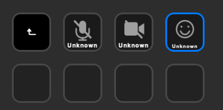
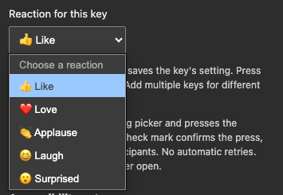

# Teams Controls for Stream Deck · macOS

**Your Teams meeting controls, one key away.**

<p align="center">
  
</p>

*Actual Stream Deck capture: microphone, camera, and reactions. No meeting controls
were accessible at capture time, so the keys correctly show **Unknown** and block
presses. These are real screenshots, not staged live-state indicators.*

An unofficial Stream Deck plugin for **Microsoft Teams microphone, camera, and
meeting reactions**, using the actual macOS Accessibility controls instead of
keyboard shortcuts or Microsoft's local third-party API.

**Experimental · English-language Teams only · MIT licensed**

- **Microphone:** toggle mute and follow changes made inside Teams.
- **Camera:** toggle the camera with independent on/off feedback.
- **Reactions:** configure each key as Like, Love, Applause, Laugh, or Surprised.
- **Local runtime:** no cloud service, telemetry, API tokens, or Graph permissions.
- **Conservative controls:** unknown/disabled/stale state blocks presses;
  ambiguous controls are not guessed and presses are never automatically retried.

> This is UI automation, **not a microphone/camera privacy guarantee**. A Teams
> update can break detection. Test in a private call: pressing an inactive
> microphone/camera key can make you audible/visible, and reactions are public
> to meeting participants. Reaction feedback confirms a UI press, not delivery.

## Requirements

- macOS 12 or newer, Apple Silicon or Intel.
- Stream Deck 6.6 or newer; keypad actions only.
- Teams desktop with English UI and Accessibility-exposed meeting controls.
- macOS Accessibility permission for the responsible launching app/helper.

Detection was developed against Teams `26276.505.5234.9924`. Background microphone
operation has been manually tested. Camera/reaction operation, minimise/restore,
and other Teams versions need broader validation; automated tests do not
establish compatibility with a live meeting.

## Install

Build from source below, or obtain `com.local.teamsmic.streamDeckPlugin` and its
`.sha256` checksum from a release published by this repository's maintainer.
Until a release is published, build from source. CI artifacts are development
builds, not signed publisher releases.

Optionally verify the checksum from the directory containing both files:

```bash
shasum -a 256 -c com.local.teamsmic.streamDeckPlugin.sha256
open com.local.teamsmic.streamDeckPlugin
```

Accept Stream Deck's installation prompt. In the action list, expand **Teams
Mic** and add **Teams Microphone**, **Teams Camera**, or **Teams Reaction** to keys.
The legacy plugin/category/helper names are preserved intentionally so upgrades
keep existing keys and app identity.

### Accessibility setup

1. Select a key in Stream Deck and click **Request permission** in its setup panel.
2. Enable the responsible app under **System Settings → Privacy & Security →
   Accessibility**. macOS may identify **Stream Deck**, **Teams Mic Helper**, or
   another responsible launching app. Existing permission may mean no new dialog.
3. Use **Show helper** if macOS requires manually adding it with the + button:
   ```text
   ~/Library/Application Support/com.elgato.StreamDeck/Plugins/com.local.teamsmic.sdPlugin/bin/Teams Mic Helper.app
   ```
4. Join a private test call and click **Refresh status**. Fully quit/reopen Stream
   Deck if permission or the action list does not refresh.

Builds are **ad-hoc signed, not Developer ID signed or Apple notarised**. A
checksum detects changed bytes when obtained from a trusted source; it is not
publisher authentication. Do not disable Gatekeeper. Replacing an ad-hoc-signed
helper may require renewed Accessibility approval.

### Key feedback

- **Red / Muted:** Teams exposes “Unmute mic”; **green / LIVE:** “Mute mic”.
- **Red camera / Off:** “Turn camera on”; **green camera / ON:** “Turn camera off”.
- **Blue reaction / selected name:** the meeting React control or verified picker
  is available; this is not a persistent “sent” state.
- **Grey / Unknown:** unavailable, ambiguous, stale, or inaccessible; no press.
- **Grey / Updating… or Reacting…:** operation pending; further presses ignored.
- **Amber / Blocked:** Teams exposes the control but it is disabled.

Changes inside Teams are polled about every 750 ms. The helper periodically
rediscovers controls and performs a fresh bounded scan before each operation.
Missing camera/reaction controls do not invalidate a uniquely identified
microphone. A missing control does not prove you are muted or outside a call.

### Meeting reactions

Select a **Teams Reaction** key and choose its reaction in the setup panel.
Default: **Like**. Duplicate the action onto several keys for different reactions.
Changing this choice, opening setup, and refreshing status never send a reaction.



*Five reactions, saved independently for each key. This is the Stream Deck setup
panel—not a reaction being sent to a meeting.*

Pressing the physical key opens the exact meeting **React** control and presses
one enabled reaction from a toolbar containing all five exact labels, once each,
in the same window. It does not use chat's “More reactions” controls or counts.
A check mark means Accessibility accepted the button press, not that other
participants received it. Check Teams before retrying an uncertain result.

Reactions can temporarily affect focus or make other controls inaccessible. A
failure can leave the picker open; dismiss it in Teams. Raise/lower hand is not
implemented because its persistent state has not been reliably established.

## Build and test

Requires **Node.js 22+**, npm, and Xcode Command Line Tools on macOS. `.nvmrc`
selects Node 22. Stream Deck supplies its own Node 20 runtime; end users do not
need Node or Swift installed.

```bash
npm ci
npm run check       # universal native build, self-tests, JS tests, validation
npm run package     # repeats checks, creates installer and SHA-256 checksum
open dist/com.local.teamsmic.streamDeckPlugin
```

Output under `dist/`, generated `.sdPlugin` content, dependencies, and native
build products are ignored by Git. Runtime licenses are included in the package.
Use `npm run test:model` for platform-independent state-model tests. Full tests
need a built plugin. Automated tests use a **fake helper** and pure native
self-tests: they do not access Accessibility or operate a real meeting.

A separately invoked **read-only** live diagnostic, which does require access:

```bash
'com.local.teamsmic.sdPlugin/bin/Teams Mic Helper.app/Contents/MacOS/TeamsMicHelper' --status
```

Do not run `tools/` probes indiscriminately: `teams-mic.swift` has an explicit
mutating `mute` command, and `inspect-teams-reactions.swift --open-picker` opens
the meeting picker. Review the source and use a private test call. Never post
unredacted diagnostic output.

## Architecture

- `src/plugin.mjs`: Stream Deck client, per-key settings/state, one in-flight
  operation, helper lifecycle, and stale-state watchdog.
- `src/model.mjs`: pure state validation, presentation, and reaction configuration.
- `native/TeamsMicHelper.swift`: persistent native helper; fixed command/label
  allowlists, scoped picker detection, enabled/uniqueness checks, confirmation.
- `plugin/`: manifest template and action-aware property inspector.
- `scripts/`: universal build, generated icons, packaging, and checksum creation.
- `test/`: state model, manifest/assets, and simulated Stream Deck host tests.

The helper uses JSON Lines over stdin/stdout, with `microphone`, `camera`, and
`reaction` control tags. It starts no HTTP server. The plugin connects only to
Stream Deck's host-provided localhost WebSocket. Runtime code does not log
conversations or meeting titles. Accessibility provides `AXPress`, not an atomic
set-state operation; concurrent UI changes can race. Timeout does not guarantee
that an operation was not applied.

## Troubleshooting

- **Unknown:** read setup details; check English Teams UI, Accessibility access,
  and an accessible meeting control. Resolve duplicate call windows.
- **Helper unavailable:** fully quit/reopen Stream Deck. The plugin restores
  executable permission stripped by some installer versions. Never bypass macOS
  security protections to troubleshoot a launch failure.
- **Uncertain action:** check Teams manually before trying again. Automatic
  retries are intentionally absent.
- **Upgrade:** install the new package and fully restart Stream Deck. Existing
  action IDs are preserved; renewed Accessibility approval may be necessary.
- **Uninstall:** remove Teams Mic from Stream Deck and revoke its Accessibility
  permission if desired. No other runtime installation is needed.

## Project information

- [Contributing](CONTRIBUTING.md) · [Security and privacy](SECURITY.md)
- [Changelog](CHANGELOG.md) · [Publishing and releases](docs/PUBLISHING.md)
- [MIT license](LICENSE) · [Third-party notices](THIRD_PARTY_NOTICES.md)

This independent project is not endorsed by or affiliated with Microsoft or
Elgato. Microsoft Teams and Stream Deck are trademarks of their respective owners.
